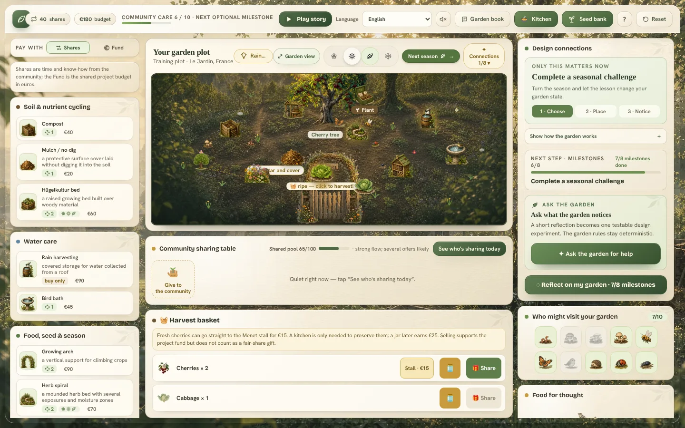
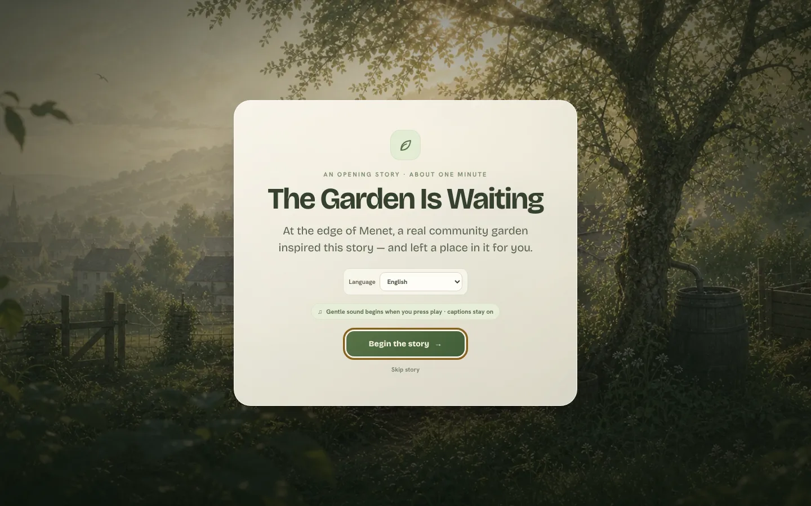
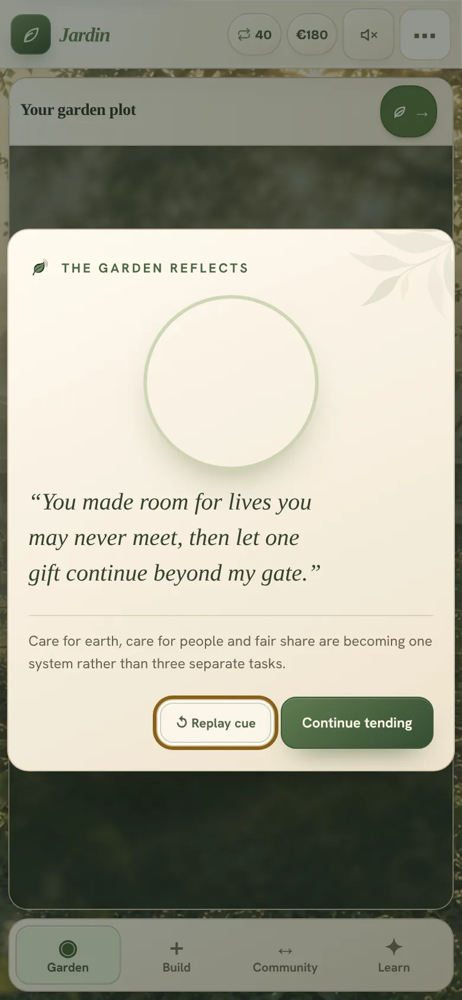

# Le Jardin — a permaculture garden game

**A story-led educational browser game about designing a living permaculture garden in Menet, France. Every placement becomes a relationship, every season changes the lesson, and an AI "Living Lesson" helps the garden reflect on what the player has actually built — without ever taking over the rules.**

[](https://permaculture-garden.vercel.app/)
[](LICENSE)
[](LICENSE-ASSETS.md)
[](https://github.com/usnea-communitas/le-jardin/actions/workflows/ci.yml)
[](#localisation)

**Play it:** <https://permaculture-garden.vercel.app/> — free, no account, progress stays in your browser.

Le Jardin is an open-source project built and maintained by [Martin Pazderník](https://github.com/martinpazdernik-source).

---



<p align="center">
  
  
</p>


## Why this garden exists

The game is inspired by a real permaculture garden in the small French village of Menet. The creator's partner joined an Erasmus+ volunteering programme there and helped a group of young people care for the garden, learn together and move the project forward.

Le Jardin was conceived first as a learning experience for that community: not a textbook that explains permaculture from a distance, but a place where a young person can try relationships, watch seasons change, make a recoverable mistake and understand why a garden works as a system. Its longer-term purpose is to support schools, youth programmes, environmental organisations and other community projects that want to introduce ecology, systems thinking and fair sharing through play.

It is an independent project and is not affiliated with or endorsed by Erasmus+.

## What the player does

Players design a living garden rather than optimise isolated objects. They place soil, water, food and habitat elements; discover useful design connections; welcome wildlife; grow, harvest and preserve seasonal food; and contribute genuine surplus to a community sharing table.

- a seven-scene, first-person cinematic introduction narrated by the Garden of Menet;
- a guided first journey and a free-exploration mode;
- four seasons with crop windows, dormancy, preservation and ecological change;
- eleven replayable learning challenges without timers or punitive failure — a wrong answer gives a clue and invites another attempt;
- eight pairwise design connections and ten wildlife relationships with a visual relationship score; the game explicitly distinguishes a useful pair from a complete plant guild;
- a garden kitchen with four preservation methods, a village stall and a seed bank;
- a fair-share economy: community gifts build a shared fund and goodwill, but never convert into personal currency;
- earned reflections, a learning journal and an exportable garden certificate;
- a workshop mode for groups, with a facilitator panel, a session log and a printable guide (see [Workshops](#workshops));
- an optional download for playing without a connection, for gardens and classrooms with a weak signal (see [Playing without a connection](#playing-without-a-connection));
- the garden saved to a file and loaded back, on another device or after the browser was cleared (see [Your garden in a file](#your-garden-in-a-file));
- an optional **Living Lesson** — an AI reflection that stays inside a deterministic learning contract (see below);
- nine interface languages; the Garden speaks English, Czech and French in its own recordings, and English elsewhere;
- desktop as the reference experience, with dedicated phone and tablet layouts in portrait and landscape, touch placement, keyboard navigation and reduced-motion support.

## Workshops

A teacher who finds the game alone sees *Playing with a group?* on the opening story's cover and in *How to play*: two sentences, a link to workshop mode and one to the facilitator guide in their language (English, Czech or French). For a group, open the game with `?workshop=1` (for example <https://permaculture-garden.vercel.app/?workshop=1&lang=cs>; add `&act=3` to preselect a start point):

- the workshop garden is saved apart from anyone's own game on the device, which is never read, changed or cleared;
- the opening card asks where the group begins: with the opening story or at any of the six acts, the earlier acts already done with plain elements placed far apart, so every design connection is still the group's to find;
- the Living Lesson answers only from the reviewed offline lessons: no AI, no cost, the same lesson for every group;
- *Workshop* replaces *Reset* in the header and opens a panel for the facilitator: where the group is and a question to ask, the six acts with their learning goals, a session log that stays on the device (save as a text file or print), the guide and *Prepare for the next group*;
- *Garden file* saves the group's garden to a file and loads it back, so a group can go on after the device was prepared for the next group, or on another device.

The facilitator guide in English, Czech and French — the six acts, the solutions to all eleven challenges, questions for the closing conversation and plans for 45, 90 and 120 minutes — is in [`docs/facilitator/`](docs/facilitator/), with PDFs to print. Its challenge chapter is generated from the game's catalogues (`node scripts/facilitator-guide.mjs`). Playtests use the kit in [`docs/playtest/`](docs/playtest/).

## The Living Lesson: AI that reflects instead of ruling

**The Garden Reflects — Living Lesson** puts a language model inside the learning loop instead of placing a chatbot next to the game:

1. The client derives a bounded, anonymous snapshot of the player's current garden.
2. `lib/living-lesson.js` generates two to four valid, *measurable* design experiments from that state.
3. `api/garden-reflection.js` sends the snapshot and the trusted candidates to the model through Vercel AI Gateway.
4. The model picks one candidate and expresses the current relationships as a first-person garden observation, a concise ecological explanation and one Socratic question — in the player's language.
5. The player accepts the experiment and changes the real garden.
6. The deterministic engine — not the model — checks the new state and records the evidence.

The model cannot invent an action, modify the economy, award points or decide whether its own experiment passed. Its output is structured, normalised and matched back to the server-generated candidate list. If live inference is unavailable, a reviewed deterministic lesson keeps the feature useful and is clearly labelled **Garden wisdom offline**; the GPT‑5.6 Luna credit appears only on lessons the model actually wrote.

**Privacy, safety and cost boundaries**

- No provider credential is shipped to the browser; production requests authenticate with Vercel's automatically supplied OIDC token.
- The model receives only element types, season, relationship metrics, bounded progression counts and a language code. Player name, free-text reflections and the save file never leave the browser.
- The endpoint rejects requests without a matching `Origin`, regenerates the candidates server-side and validates the structured response before returning it. The `Origin` check keeps other websites from using a visitor's browser; a script can still send the header, so the limits below and the credit are the real brake. Challenge and guild entries in the snapshot pass only as identifiers (`compost`, `foodForest`), so free text never reaches the prompt.
- Application code does not log prompts or player state; routing identifiers are hashed.
- Stable state fingerprints enable caching; the client allows three uncached requests per browser per day, and the function adds a 12-second timeout, a 320-token output cap and its own limits: 6 requests per minute per IP address, 12 per day per client and 240 per day in total, with answers cached for six hours. Those limits and the cache live in the memory of each function instance, so a cold start resets them and concurrent instances count separately: they are a cost brake, not an exact global quota. The hard ceiling is the AI Gateway credit; when it runs out, the endpoint serves the offline lesson.
- If credit, authentication or the provider is unavailable, the endpoint returns a deterministic lesson without further model cost and without breaking the game. The player then sees the reviewed lesson labelled *Garden wisdom offline — no AI wrote these words*, never an error or the provider's message. `scripts/test-living-lesson-api.mjs` simulates each case: credit used up, a provider limit, a refused token, a server error, a timeout and no network.

## Localisation

The interface is fully localised in nine languages: English, Czech, German, French, Spanish, Brazilian Portuguese, Polish, Russian and Simplified Chinese. English is the source catalogue (`assets/i18n/catalog.en.json`, about 1,800 keys); every other catalogue must have the same structure, which `npm run check:i18n` enforces. Terminology decisions live in `assets/i18n/LOCALIZATION_GLOSSARY.md`.

The language follows the browser's preferred language when it is supported and falls back to English otherwise; the player can switch languages in the interface, and the choice is kept in the URL and in local storage.

The Garden's voice — the seven story scenes and 42 lines in the garden — is recorded in English, Czech and French; the other six languages hear English and the game says so. Each voiced language has a list of its 49 recordings, `assets/i18n/audio.<locale>.json`, with the spoken text: `node scripts/sync-audio-captions.mjs <locale>` copies it into the catalogue, so the subtitles say exactly what the voice says, and `scripts/normalize-voice.mjs` levels new takes (−16 LUFS, mono MP3 with a length header) and records their lengths. A recording that cannot load falls back to the English one. How the voices were made and chosen is in [`docs/ASSET_PROVENANCE.md`](docs/ASSET_PROVENANCE.md).

Translation corrections and new languages are welcome — see [CONTRIBUTING.md](CONTRIBUTING.md).

## Your garden in a file

The garden is kept only in this browser's storage. *Garden file* (the page with a leaf in the header; on a phone, in the ••• menu) saves it as a small JSON file and loads it back: on another device, in another browser or after the browser's data was cleared. The file says which game and which version made it; a damaged file, another app's file or a file from a newer version is refused before anything changes, and loading over a garden in progress asks first. In workshop mode the file holds the group's garden, never anyone's own game.

The game also guards the garden it keeps. Once a garden has elements, it asks the browser to keep its storage instead of clearing it when space runs low (not in Firefox, where that shows the player a prompt, and never in a workshop on a shared device). When the browser refuses a save, a message says so and offers the garden file, which carries the garden as it is on screen. When the same garden is open in two tabs and one of them saves it, the other stops saving, says so and loads the newer garden on request, so neither tab writes over the other. The helper (`lib/garden-file.js`) loads only when it is needed, and nothing is sent anywhere.

## Playing without a connection

*Play without a connection* (the arrow in the header; on a phone, in the ••• menu) downloads the game to the device: the game itself and its pictures and sounds, English and the chosen language, and, if the player keeps them, the Garden's voice and the music — about 20 MB, 29 MB with the voice and 35 MB with music too. Afterwards the game, the workshop link included, opens and plays without a connection; other languages and the moving pictures still need one (the game shows still pictures instead). The panel shows the size before anything is downloaded and can remove the download again; the garden itself always stays in the browser's storage, and nothing is sent anywhere.

Nothing changes for a player who never chooses it: the service worker (`sw.js`) is registered only after a download, and the helper (`lib/offline.js`) loads only when the panel opens. The worker answers from the download made for its own build, so a page never mixes two versions; a newer build downloads in the background, copying unchanged files instead of fetching them again, and starts the next time the game opens, with the garden in progress intact.

On iPhone and iPad, a game added to the Home Screen keeps its own storage, separate from Safari: the download (and the garden) have to be made there as well.

## Architecture

The game is a local-first static site generated from a single editable source into a small loading shell and a prebuilt game fragment. One serverless function is the only server boundary.

| Path | Role |
| --- | --- |
| `Permaculture Garden v2.dc.html` | **The canonical source**: template, styles and the game class, which keeps every word, picture and sound and asks the rule modules. Edit this, then run `npm run generate`. |
| `index.html`, `game.fragment.html`, `game.logic.js`, `offline-manifest.json` | Generated output — never edit by hand (`sw.js` too gets its version from the build). |
| `scripts/build.mjs` | Builds the loading shell, the game fragment and the game's logic class (`game.logic.js`) from the source. |
| `scripts/check.mjs`, `scripts/check-i18n.mjs` | Validate script syntax, local resource references, production invariants and catalogue completeness. |
| `assets/i18n/audio.cs.json`, `audio.fr.json` | The Garden's 49 recorded lines in Czech and French: file, spoken text and length. `scripts/test-voice.mjs` checks that no recording is missing, that each has a length header and that the subtitles match. |
| `lib/economy.js`, `lib/community-table.js`, `lib/seasons.js`, `lib/acts.js`, `lib/wildlife.js` | **The rules of the game**: prices and fair-share gifts, the community table, planting and harvest windows, the six acts, and the wild neighbours and pests. Pure functions with unit tests (`npm run test:rules`); how they fit together and how to change a rule is in [docs/ARCHITECTURE.md](docs/ARCHITECTURE.md). |
| `lib/i18n.js` | Runtime localisation: locale detection, catalogue loading, formatting. |
| `lib/living-lesson.js` | The deterministic experiment engine shared by client and server. |
| `lib/workshop.js` | Workshop mode: the link, the separate save, the garden at the start of each act and the session log. |
| `lib/garden-file.js` | The garden in a file: what a saved file holds, the checks before one is loaded, its name, and where asking to keep the storage would show a prompt. |
| `lib/offline.js`, `sw.js` | Playing without a connection: the package for a choice, the download into a cache named after the build, and the service worker that answers from it (byte ranges included). |
| `offline-manifest.json` | Generated list of every file in the offline package with its size and hash; its version is stamped into `sw.js`. `scripts/offline-manifest.mjs` places every file under `assets/` in a group, and the build stops when a new file belongs to none. |
| `api/garden-reflection.js` | The protected Vercel Function and the model boundary. |
| `assets/` | Local WebP art, MP3 audio, fonts, icons, the ambient video and the i18n catalogues. |
| `vendor/` | Bundled React runtime and the Design Component runtime used by the static game. |
| `scripts/e2e-*.mjs` | Playwright browser journeys (see below). |
| `docs/` | The facilitator guide, the playtest kit, release handoffs, Build Week records and asset provenance. |

Player progress is stored locally in the browser. No account or external database is required.

## Install, build and test

Requirements: Node.js 22+ and npm (the API tests use `module.registerHooks`, available from Node 22.15).

```sh
npm ci
npm run generate   # rebuild index.html, game.fragment.html and game.logic.js from the canonical source
npm test           # structural checks, i18n catalogue checks, Living Lesson engine and API tests, the rules of the game, workshop mode and guide, offline package, the recorded voice, the garden file, the media budget
```

Serve the static build locally:

```sh
node scripts/static-server.mjs 8787
```

Then open <http://127.0.0.1:8787/>. The local server has no Vercel Function or OIDC identity, so the Living Lesson intentionally exercises its offline path.

### Browser regression journeys

The `test:e2e:*` scripts are Playwright journeys. Playwright is a development dependency, so `npm ci` installs it; download its Chromium once. Each journey serves the static build on a free local port by itself:

```sh
npx playwright install chromium # once; add --with-deps on a fresh Linux machine
npm run test:e2e:responsive     # 13 viewports from 320×568 to 1920×1080
npm run test:e2e:touch          # tap-to-place and tap-to-move
npm run test:e2e:playthrough    # a full guided playthrough
npm run test:e2e:i18n-layout    # 9 languages × desktop, tablet, phone × 15 surfaces (also in CI)
npm run test:e2e:living-lesson  # reflection flow, caching, offline fallback
npm run test:e2e:workshop       # workshop mode: start at an act, offline lesson, log, next group
npm run test:e2e:offline        # download, the first act with the server switched off, an update, removal
npm run test:e2e:voice          # the Garden speaks French and Czech from story to garden, English elsewhere, with fallback
npm run test:e2e:garden-file    # the garden in a file: save and load, refusals, workshop, the phone menu
npm run test:e2e:resilience     # damaged saves, a full browser, two tabs of one garden, reset
npm run test:e2e:core           # what CI runs: playthrough, touch, responsive, Living Lesson, release audit, workshop, offline, voice, garden file, resilience
node scripts/run-local-e2e.mjs scripts/measure-start.mjs   # where the start spends its time on a phone (docs/START-PERFORMANCE.md)
```

Audits without an npm alias, such as `node scripts/e2e-accessibility.mjs`, `e2e-journey.mjs` or `e2e-layout-audit.mjs`, test the instance in `GAME_URL` (by default <http://127.0.0.1:8787/>), so start `node scripts/static-server.mjs 8787` first. `npm run test:production` plays the live site from the story cover to the first seasonal challenge without calling the Living Lesson API. To use a Playwright installed elsewhere, point `CODEX_NODE_MODULES` at that `node_modules` folder (plain npm or pnpm layout).

Coverage includes adaptive navigation, safe-area and overflow boundaries, 44-pixel touch targets, the 7:5 interactive plot, orientation-preserved state, all Garden Book chapters, all eleven challenges, the kitchen and seed bank, the fair-share economy invariants, snapshot sanitisation, stable fingerprints, response normalisation and outage fallback.

## Deployment

`main` deploys to the Vercel project behind <https://permaculture-garden.vercel.app/> with the **Other** framework preset and no custom build command; `vercel.json` only sets security headers and the cache for fonts and media; Vercel installs locked dependencies from `package-lock.json`. The Living Lesson function needs an AI Gateway credential on the Vercel side only (`AI_GATEWAY_API_KEY`, or the platform OIDC token); nothing is required in the browser. [`.env.example`](.env.example) lists the optional variables for local work.

After every production deployment the *Production smoke test* workflow (`.github/workflows/production-smoke.yml`) runs `npm run test:production` on the deployed commit with `EXPECT_LOCAL_BUILD=1`: the live site must serve exactly that commit's `index.html`, `game.fragment.html` and `game.logic.js`, and the short playthrough must pass without console errors. It never blocks a deploy; a failure shows on the commit and in Actions.

## Project history

- **Prototype (spring–July 2026)** — a single-file browser prototype with the core placement garden, seasons, guilds, wildlife and sharing.
- **OpenAI Build Week (13–19 July 2026)** — the prototype was rebuilt into a complete product with Codex as engineering collaborator: the eleven challenges, the cinematic introduction, the organic soundscape, hardened saving and progression, the Living Lesson architecture and the first automated journeys. The entry did not place; the submission text and provenance records are kept in [`docs/build-week/`](docs/build-week/).
- **Playtest line (v0.78–v0.82, late July 2026)** — nine full language versions, Czech narration, the garden kitchen and seed bank, a rebalanced economy, adjustable garden size, phone and tablet layouts, and a growing set of browser regression journeys. Release notes live in [`docs/handoffs/`](docs/handoffs/) and in [CHANGELOG.md](CHANGELOG.md).
- **Le Jardin (September 2026 →)** — the repository moved to its current GitHub organisation, the name was unified to *Le Jardin*, the API boundary was hardened and accessibility contrast was improved.
- **Open-source release v0.83.0 (24 October 2026)** — the repository was made public under the MIT licence (CC BY-NC-SA for media), with the unified Build Week + playtest history, CI, a changelog and contributor documentation.
- **v0.84.0 (10 November 2026)** — every text in the player's language in all nine versions, lighter media for phones, one Resilience score shared by the ring, card and certificate, and a check of the live game after every deployment. Details in [CHANGELOG.md](CHANGELOG.md).
- **v0.85.0 (12 November 2026)** — a workshop mode for groups with a facilitator guide in English, Czech and French, a playtest kit, a faster first start on phones, security headers and caching, and a header that fits laptop windows in every language. Details in [CHANGELOG.md](CHANGELOG.md).
- **v0.87.0 (14 November 2026)** — the story's first painting shows while the game starts, the game's logic arrives as a script of its own (Lighthouse's phone: performance median 86.5 → 93 against the live site), and a garden file chosen before the game was ready waits instead of being refused. Details in [CHANGELOG.md](CHANGELOG.md).
- **v0.86.0 (13 November 2026)** — the game plays without a connection, the Garden speaks French, a garden can be saved to a file and no longer disappears unnoticed, groups find workshop mode from the cover, and the translations, layouts and the engines of Safari and Firefox are checked in CI. Details in [CHANGELOG.md](CHANGELOG.md).

Planned next — tracked as issues: [first playtests with young people and facilitators](https://github.com/usnea-communitas/le-jardin/issues/8), [facilitator tools](https://github.com/usnea-communitas/le-jardin/issues/7), a [shared workshop mode](https://github.com/usnea-communitas/le-jardin/issues/4) for groups of 10–25 players where each person tends their own garden around a common Community Table, [voice narration for the remaining six languages](https://github.com/usnea-communitas/le-jardin/issues/5) and a [performance and media-budget audit](https://github.com/usnea-communitas/le-jardin/issues/6).

## Contributing

Issues and pull requests are welcome — bug reports, translation fixes, accessibility findings, playtest observations and educational content ideas most of all. Please read [CONTRIBUTING.md](CONTRIBUTING.md) first; it explains the canonical-source workflow (`npm run generate` after every change) and what we check before merging. This project follows the [Contributor Covenant](CODE_OF_CONDUCT.md). Security concerns: see [SECURITY.md](SECURITY.md).

## License

- **Code** (HTML, JavaScript, CSS, build and test scripts): [MIT License](LICENSE), © 2026 Martin Pazderník.
- **Game media and texts** (artwork, audio, video, narrative and learning texts in `assets/` and in the source): [Creative Commons Attribution-NonCommercial-ShareAlike 4.0 International](LICENSE-ASSETS.md), © 2026 Martin Pazderník, with the attributions listed there.
- Bundled open-source dependencies and fonts keep their own licences; see [THIRD_PARTY_NOTICES.md](THIRD_PARTY_NOTICES.md) and [`licenses/`](licenses/).

## Acknowledgements

The garden in Menet and the young people who care for it; the Erasmus+ volunteers whose experience inspired the game; Robin Wall Kimmerer's *The Serviceberry* for the idea of a gift economy that shapes the sharing mechanics; and the open-source projects this game is built on.

OpenAI, GPT, Codex, Vercel, ElevenLabs, Kling, Picsart, Lovable and Erasmus+ are names or marks of their respective owners and are referenced only to describe tools or historical context.
